# Informe técnico — Comparativo de lenguajes (Java, Scala y C#)

**Proyecto:** Sistema de matchmaking y gestión de torneos de e-sports
**Curso:** Lenguajes y Paradigmas — Examen final
**Ejecución de referencia:** 17 de noviembre de 2026 (ver sección 5.4 y `resultados/entorno.json`)

---

## 1. Introducción

El objetivo no es solo programar el mismo sistema tres veces, sino **diseñar un experimento** que mida métricas reales y
construir un **mecanismo automático** que consolide los resultados, clasifique los lenguajes y determine cuál es el más
conveniente para el problema, con evidencia cuantitativa y reglas verificables.

Se implementó el mismo sistema en:

- **Java 17+**, con enfoque declarativo basado en la API de *Streams*, *records*, lambdas e interfaces funcionales.
- **Scala 2.13**, usando **exclusivamente** las construcciones de la tabla de clase (sin `groupBy`, `sortBy`,
  `Option`, etc.), lo que obliga a resolver ordenamientos y agrupaciones con recursión, `map`, `filter` y `fold`.
- **C# / .NET 8**, el lenguaje elegido por el grupo, con LINQ, *records*, *switch expressions* y tuplas.

## 2. Descripción del problema

Un sistema que organiza torneos de videojuegos:

| Funcionalidad | Qué hace |
|---|---|
| Carga | Lee jugadores desde un CSV compartido (`id,nombre,elo`; Elo vacío = 1000). |
| Elo | Probabilidad esperada y actualización con K = 32. |
| Matchmaking | Ordena por Elo y empareja por cercanía (1.º-2.º, 3.º-4.º…); si es impar, el último recibe BYE. |
| Eliminación directa | Genera las llaves ronda a ronda hasta obtener un campeón (con BYEs cuando *n* no es potencia de 2). |
| Liga | Todos contra todos en grupos de 64, 3/1/0 puntos, tabla con desempate puntos → Elo → id. |
| Estadísticas | Agrupación por rango (bronce, plata, oro, platino), Elo promedio, top 10, victorias por rango. |
| Errores | Archivo inexistente, líneas mal formadas, Elo negativo/nulo, torneo con < 2 jugadores e ids duplicados: se registran sin detener el programa. |

### 2.1 Sistema Elo

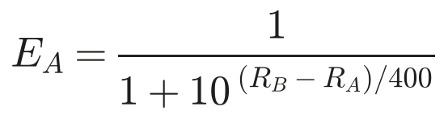 &nbsp;&nbsp; 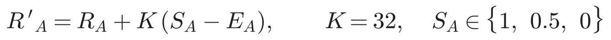

**Ejemplo numérico:** un jugador de 1600 contra uno de 1400 tiene E = 1 / (1 + 10^(−200/400)) = 1 / (1 + 0,3162) = **0,7597**.
Si gana, sube 32·(1 − 0,7597) = **+7,69** puntos; si perdiera, bajaría 32·(0 − 0,7597) = −24,31. Entre jugadores iguales
(E = 0,5) la victoria vale exactamente ±16. Estos tres valores están verificados en las pruebas unitarias de los tres lenguajes.

## 3. Diseño

### 3.1 Arquitectura común

Los tres proyectos tienen las mismas capas y las mismas firmas (adaptadas a cada lenguaje):

```
modelo/          Jugador, Partida, Emparejamiento (Pareja | Bye), RegistroError, resultados inmutables
dominio/         Elo, GeneradorLCG, Matchmaking, EliminacionDirecta, Liga, Estadisticas, Validacion,
                 Invariantes, Pipeline            <- funciones puras
infra/           CargadorCsv, Cronometro, Memoria, SalidaNormalizada, EscritorJson, Main  <- efectos (bordes)
```

`Pipeline.ejecutar(ruta, semilla, tamGrupo, cronometro)` compone las fases:
**carga → matchmaking → eliminación → liga → estadísticas**. Los efectos secundarios (leer el CSV, escribir el JSON,
medir tiempo y memoria) están **aislados en los bordes** (`infra/` en Java, `Infra/` en C#, `Infraestructura.scala` en
Scala). El orquestador verifica automáticamente que no haya efectos fuera de esos archivos.

### 3.2 Decisiones clave para la equivalencia y el determinismo

**1.** **Generador pseudoaleatorio propio (LCG de 64 bits)** con las mismas constantes en los tres lenguajes:

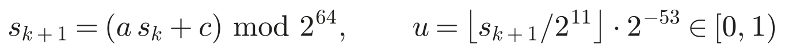

con *a* = 6364136223846793005 y *c* = 1442695040888963407. `java.util.Random`, `scala.util.Random` y `System.Random`
producen secuencias distintas, por eso no se usan.

**2.** **El aleatorio de cada partida es una función pura de (semilla, ronda, índice)**: se crea un generador local con la
semilla mezclada con la clave de la partida. Así el resultado no depende del orden en que el lenguaje evalúe las
partidas (servirá igual con *streams* paralelos) y no hay estado compartido.

**3.** **Elo en centésimas enteras.** 1534,50 se guarda como 153450. La variación se redondea así:

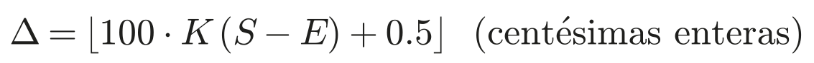

Sumar enteros es exacto y conmutativo, así que la suma de variaciones da lo mismo aunque Java use `Collectors`,
C# use `Sum` vectorizado y Scala use `fold`. (Con `double` las sumas dependen del orden y los hashes no coincidirían.)

**4.** **Liga con Elo "por lotes"** (como la FIDE): cada partida usa el Elo con el que el jugador empezó la liga y las
variaciones se suman al final. Esto hace que el resultado de cada partida sea independiente del orden y permite
agregar con una reducción asociativa.

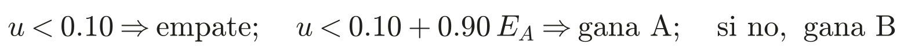

**5.** **Salida normalizada + SHA-256.** Cada programa escribe un texto canónico (campeón, Elo final, tabla completa del grupo 1,
líderes de todos los grupos, sumas de verificación de todos los Elo finales, estadísticas, top 10 y conteo de errores
por tipo) y calcula su SHA-256. El orquestador compara los hashes.

### 3.3 Contrato de la línea de comandos y del JSON

```
--input datos.csv --mode all --runs 10 --warmup 3 --out resultado.json [--seed 20261117] [--grupo 64]
```

El JSON de salida tiene el mismo esquema en los tres lenguajes: `tiemposMs` (cada ejecución por fase), `resumenMs`
(mediana, media, desviación, mínimo y máximo), `memoria`, `throughput`, `conteos`, `errores` (total, por tipo y detalle),
`resultado` (campeón, llaves, tabla, top 10, estadísticas), `invariantesOk`, `salidaNormalizada` y `hashSalida`.

### 3.4 Particularidades de cada implementación

**Java (Streams).** `EliminacionDirecta` genera la secuencia de rondas con `Stream.iterate(estado, siguienteRonda)` y
`dropWhile`: cada ronda se produce transformando la colección anterior, sin mutación. La liga usa
`IntStream.range(...).boxed().flatMap(...)` para el todos contra todos y `Collectors.toMap(..., Aporte::sumar)` para la
tabla; la validación usa `Collectors.partitioningBy`; las estadísticas `groupingBy` + `summarizingLong`; el máximo de
victorias `reduce`. Los datos son `record` y el modelo de emparejamientos es una `sealed interface`.
No hay ni un solo `for`/`while` en el código de Java.

**Scala (tabla de clase).** Como no se permiten `sortBy`, `groupBy`, `take`, `reverse`, `Option`…, se implementaron
utilidades propias en `Listas.scala` con *pattern matching* sobre `::` y `Nil`:

- **Merge sort de abajo hacia arriba:** `lista.map(x => List(x))` y luego mezclar por pares, nivel a nivel: O(n log n).
  *Decisión justificada:* combinar las listas unitarias con un `fold` lineal (la sugerencia del enunciado) equivale a un
  ordenamiento por inserción O(n²): con 131.072 jugadores serían ≈ 8.600 millones de comparaciones.
- **Recursión de cola** (`invertir`, `cortar`, `emparejar`, `mezclar`…): el compilador la convierte en un ciclo, por
  eso no se desborda la pila con 131.072 o 1.000.000 de jugadores.
- **Agrupación por rango:** cada jugador se convierte en un `Map` de un solo elemento y se combinan con
  `fold(Map())(combinar)`. La tabla de la liga se agrupa con recursión + `Map` (`+`, `getOrElse`).
- `var`, `while` y `do-while` solo donde se justifican (estado del LCG, lectura del CSV, ciclo de mediciones), con comentario.
- Se usa **Scala 2.13** porque Scala 3 eliminó `do-while`.
- Toda la API de librería (java.io, `System.nanoTime`, MXBeans, `MessageDigest`, `split`/`trim`) está aislada en
  `Infraestructura.scala`.

**C# (LINQ).** `Chunk(2)` para emparejar y `Chunk(64)` para los grupos, `SelectMany` para el todos contra todos,
`GroupBy` + `ToDictionary` + `Aggregate` para la tabla, `OrderByDescending().ThenBy()` para el seeding, `Zip` + `Skip` +
`All` para verificar invariantes, *switch expressions* con patrones posicionales (`Pareja(var a, var b) => ...`),
`record` con expresiones `with` para la inmutabilidad y `InvariantGlobalization` para que el formato numérico no dependa
de la configuración regional de Windows.

## 4. Metodología experimental

### 4.1 Escenarios (generador reproducible con semilla fija)

| Escenario | Jugadores | Partidas por ejecución | Propósito |
|---|---|---|---|
| pequeño | 64 | 63 + 2.016 | arranque y latencia |
| mediano | 1.024 | 1.023 + 32.256 | carga media |
| grande | 16.384 | 16.383 + 516.096 | carga alta |
| muy grande | 131.072 | 131.071 + 4.128.768 | escalabilidad |
| extremo (opcional) | 1.000.000 | 999.999 + ~31,5 M | límite |
| sucio | 999 válidos + 30 errores + línea en blanco | — | confiabilidad |
| mínimo | 1 válido + 1 malformado | — | torneo insuficiente |
| inexistente | — | — | archivo que no existe |

Cada escenario ejecuta matchmaking + eliminación directa + liga (grupos de 64) + estadísticas.


### 4.2 Instrumentación

| Métrica | Instrumento |
|---|---|
| Tiempo por fase y total | `System.nanoTime()` (Java/Scala), `Stopwatch` (C#) |
| Memoria interna | `Runtime` + `MemoryPoolMXBean` (pico por pool) en la JVM; `GC.GetTotalMemory` y `Process.PeakWorkingSet64` en .NET |
| Memoria externa (la usada en el ranking) | el orquestador sondea el proceso cada 20 ms (`psutil`; `VmHWM` en Linux, `peak_wset` en Windows) |
| Throughput | partidas procesadas por segundo y jugadores por segundo (con la mediana del tiempo total) |
| Calidad y uso funcional | análisis estático con reglas explícitas (`orquestador/calidad.py`) |
| Confiabilidad | pruebas unitarias, errores esperados vs. detectados (`errores_esperados.json`) y hash |

### 4.3 Rigor

- **3 ejecuciones de calentamiento** descartadas (JIT de la JVM y compilación por niveles de .NET) y **10 medidas**.
- Se reportan **mediana, media, desviación estándar muestral, mínimo y máximo**. El ranking usa la **mediana** porque es
  robusta frente a pausas aisladas del recolector de basura.
- Condiciones equivalentes: misma máquina, mismos CSV, misma semilla, mismo número de ejecuciones, ejecución intercalada
  de los lenguajes por escenario, JVM con `-Xms256m -Xmx3g -XX:+UseG1GC` para Java y Scala, .NET en modo Release.

### 4.4 Consolidación y clasificación automática

**1.** Se verifica la equivalencia: la referencia de cada escenario es el hash de la mayoría; quien no coincida pierde puntos
de confiabilidad y se reporta.

**2.** Tiempo, memoria y rendimiento se normalizan **por escenario** con min-max y luego se promedian (así cada escenario pesa igual):

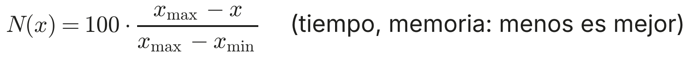

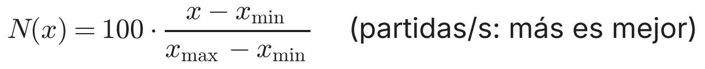

**3.** Calidad, confiabilidad y uso funcional ya están en escala 0–100 por reglas explícitas:

- **Calidad** = promedio de 6 sub-puntajes: LOC relativo (100·LOC mín./LOC), complejidad ciclomática promedio (≤ 2 → 100,
≥ 10 → 0), anidamiento máximo (≤ 4 → 100, ≥ 9 → 0), % de operaciones funcionales, duplicación (0 % → 100, ≥ 15 % → 0)
y efectos fuera de los bordes (−20 por cada uno).
- **Uso funcional** = 50 % ratio funcional + 50 % cumplimiento de las construcciones exigidas (Java: 20 construcciones de
Streams; C#: 18 de LINQ; Scala: cobertura de las 37 construcciones de la tabla).
- **Escáner de Scala:** busca cada término PROHIBIDO como *token* en el código sin comentarios ni textos (fuentes y
pruebas) y otros métodos de colecciones fuera de la tabla; cada violación descuenta 10 puntos en calidad y en uso funcional.
- **Confiabilidad:**

<p>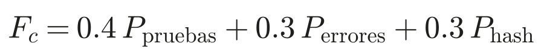</p>

**4.** Puntaje total con los pesos del enunciado:

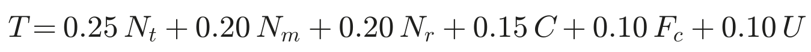

**5.** Sensibilidad: cada peso ±5 puntos (la diferencia se reparte proporcionalmente) y, además, el mismo cálculo con
normalización proporcional (100·mejor/valor).

## 5. Resultados (ejecución de referencia)

### 5.1 Clasificación final

| Pos. | Lenguaje | Tiempo (25) | Memoria (20) | Rendimiento (20) | Calidad (15) | Confiabilidad (10) | Uso funcional (10) | **Total** |
|---|---|---|---|---|---|---|---|---|
| 🥇 1 | **Java** | 18,75 | 7,91 | 15,00 | 13,96 | 10,00 | 10,00 | **75,61** |
| 🥈 2 | C# | 7,25 | 20,00 | 5,53 | 14,88 | 10,00 | 10,00 | **67,65** |
| 🥉 3 | Scala | 3,08 | 0,00 | 1,58 | 13,80 | 10,00 | 9,39 | **37,86** |

| Criterio | Java (cruda → norm.) | Scala | C# |
|---|---|---|---|
| Tiempo (media geométrica de medianas) | 75,8 ms → 75,0 | 97,0 ms → 12,3 | 72,7 ms → 29,0 |
| Memoria pico (media geométrica) | 388 MB → 39,5 | 525 MB → 0,0 | 145 MB → 100,0 |
| Rendimiento (media geométrica) | 1,48 M partidas/s → 75,0 | 1,15 M → 7,9 | 1,54 M → 27,7 |
| Calidad de código | 93,0 | 92,0 | 99,2 |
| Confiabilidad | 100 | 100 | 100 |
| Uso funcional | 100 | 93,9 | 100 |

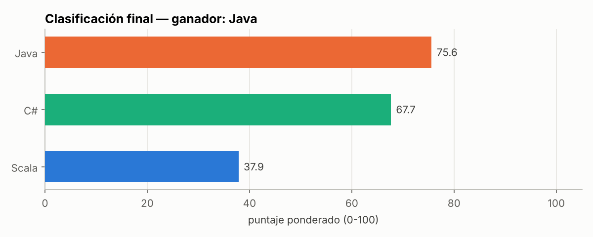

### 5.2 Rendimiento por escenario (mediana de 10 ejecuciones)

| Escenario | Java ms | Scala ms | C# ms | Java MB | Scala MB | C# MB |
|---|---|---|---|---|---|---|
| pequeño (64) | 6,93 | 6,12 | **1,90** | 79 | 86 | **50** |
| mediano (1.024) | **24,25** | 27,29 | 28,21 | 224 | 310 | **174** |
| grande (16.384) | **148,25** | 250,48 | 261,98 | 599 | 1.057 | **188** |
| muy grande (131.072) | **1.323,64** | 2.111,83 | 1.986,31 | 2.130 | 2.696 | **267** |

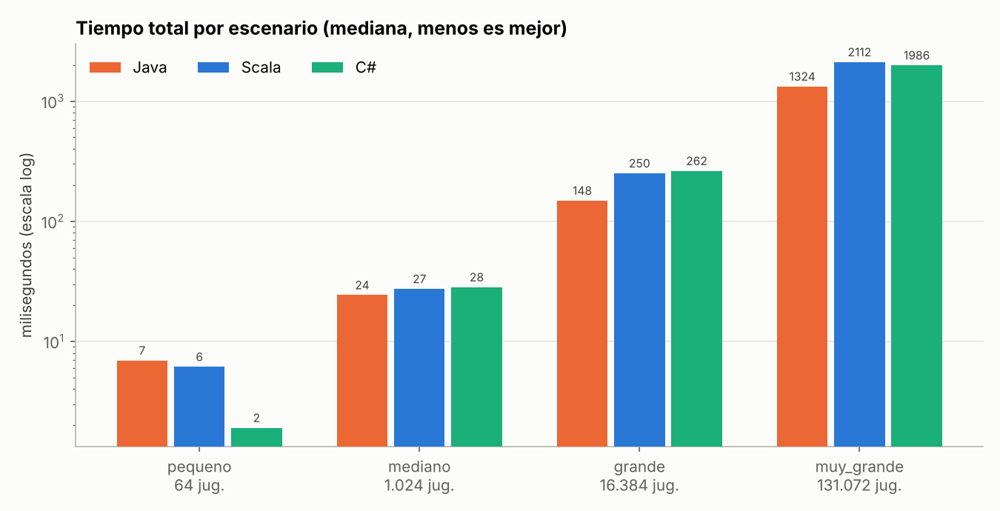
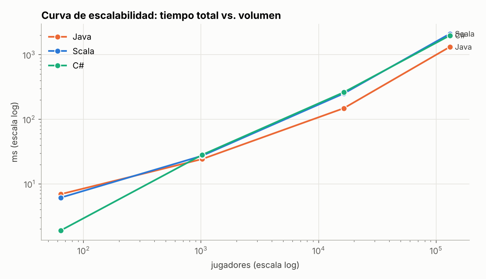
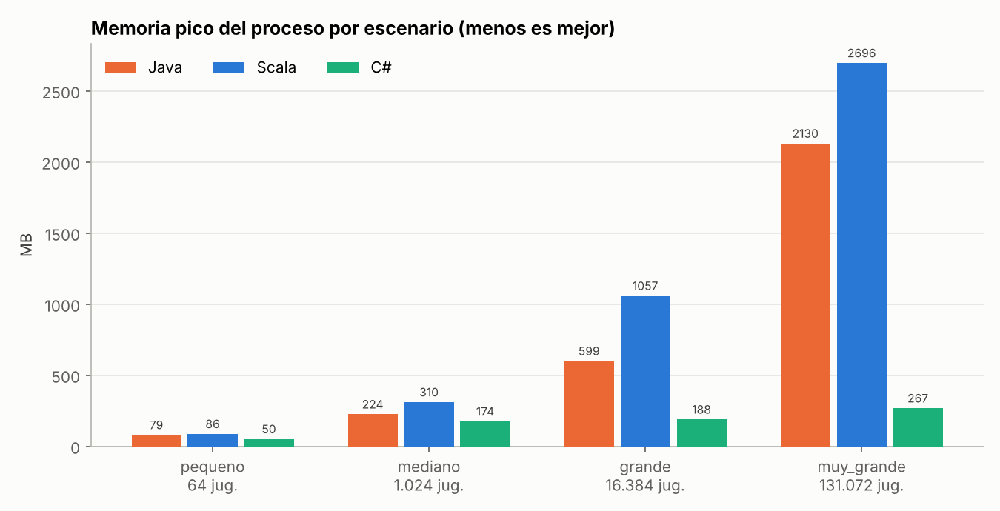
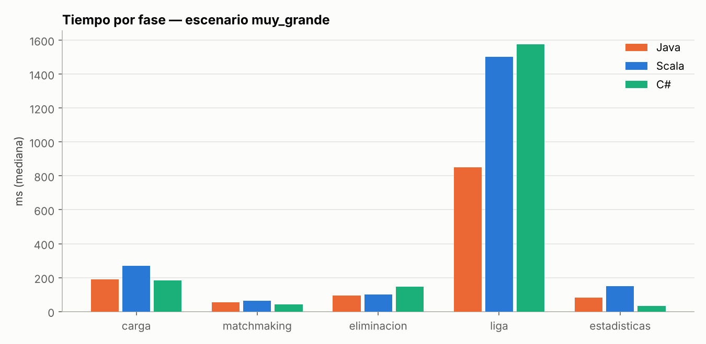

**Lectura:** C# arranca más rápido (escenario de 64 jugadores: 1,9 ms vs 6–7 ms) y usa **8 veces menos memoria** en el
escenario mayor. Java es el más rápido cuando hay volumen (1,32 s vs 1,99 s de C# y 2,11 s de Scala con 131.072
jugadores) porque el JIT C2 de HotSpot optimiza muy bien las cadenas de *streams*. La fase dominante es la **liga**
(4,1 millones de partidas): 851 ms en Java, 1.501 ms en Scala y 1.576 ms en C#. Scala paga el costo de las listas
enlazadas inmutables y de los `Map` persistentes que exige la tabla de clase.

### 5.3 Equivalencia, confiabilidad, calidad

- **Los 7 escenarios produjeron exactamente el mismo SHA-256 en los tres lenguajes** (incluidos los datos sucios, 1 jugador
  y el archivo inexistente).
- Errores detectados = errores esperados en 18/18 chequeos por lenguaje (12 líneas malformadas, 10 Elo inválidos,
  8 duplicados, torneos insuficientes y archivo inexistente).
- 23/23 pruebas unitarias aprobadas por lenguaje (Elo, LCG, matchmaking, llaves, liga y errores).
- Escáner de Scala: **0 violaciones** y **37/37** construcciones de la tabla usadas (`resultados/matriz_cobertura_scala.md`).

| Métrica estática | Java | Scala | C# |
|---|---|---|---|
| LOC (sin comentarios ni llaves solas) | 738 | 586 | **440** |
| Complejidad ciclomática promedio | **2,11** | 2,88 | 2,40 |
| Anidamiento máximo | 4 | 4 | **3** |
| % operaciones funcionales | 100 | 87,8 | 100 |
| Construcciones imperativas | 0 | 18 (exigidas por la tabla) | 0 |
| Duplicación | 0 % | 0 % | 0 % |
| Efectos fuera de los bordes | 0 | 0 | 0 |

### 5.4 Sensibilidad

- Variando cada peso ±5 puntos, **el ganador no cambia en ninguna de las 12 variaciones**; el margen entre Java y C#
  es de 7,96 puntos.
- **Con normalización proporcional el ganador sería C# (89,7 vs 80,0).** Min-max lleva siempre al peor a 0 y amplifica
  diferencias pequeñas: en media geométrica de tiempo C# incluso es un 4 % más rápido que Java (por su enorme ventaja
  en el escenario de 64 jugadores), pero en mediano y grande es el último y recibe 0 puntos en esos escenarios;
  en memoria pasa lo contrario a favor de C#.

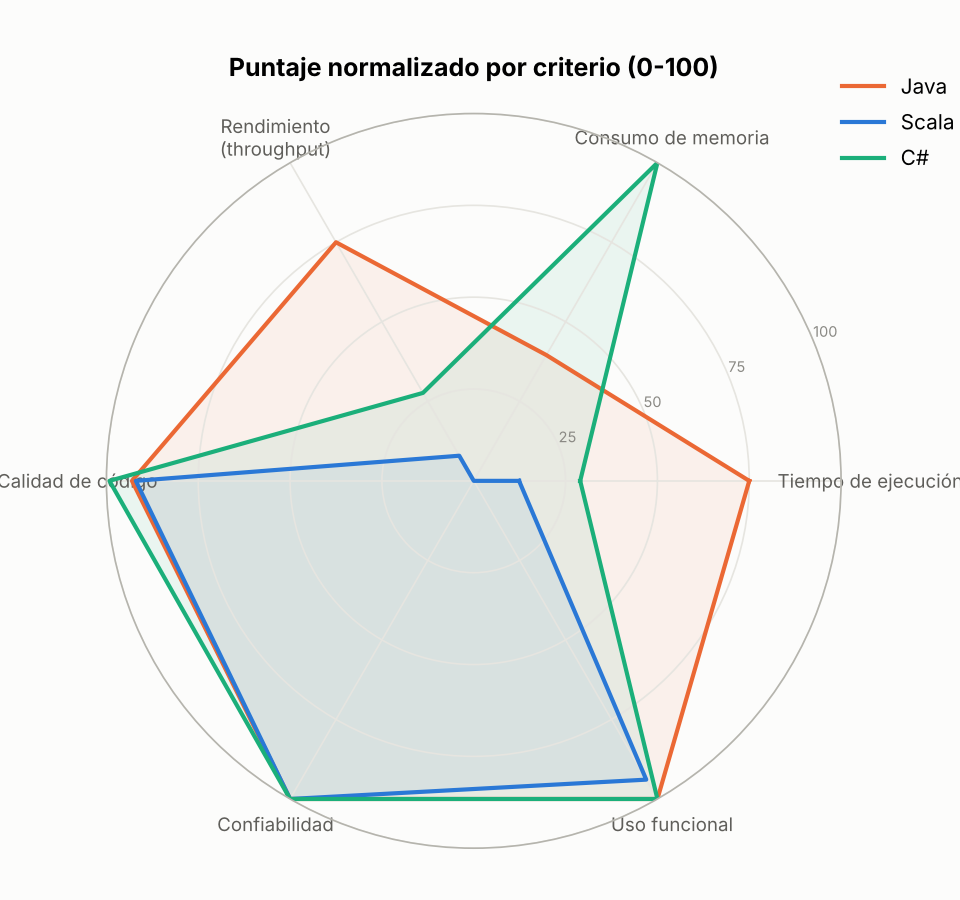

## 6. Ventajas y limitaciones de cada lenguaje

| | Ventajas | Limitaciones |
|---|---|---|
| **Java** | Mejor tiempo y throughput con volumen (JIT C2); *Streams* muy completos (`groupingBy`, `partitioningBy`, `Collectors`); *records* y *sealed interfaces*; cero bucles imperativos. | El código más largo (738 LOC: mucha ceremonia de tipos e imports); la JVM reserva bastante memoria (heap de G1 hasta `-Xmx`); arranque más lento. |
| **Scala** | Expresividad del *pattern matching* y de las funciones de orden superior; inmutabilidad natural; recursión de cola segura. | Con solo la tabla de clase hay que reimplementar ordenar, agrupar y cortar listas; las listas enlazadas y los `Map` persistentes son más lentos y usan más memoria; algunas construcciones imperativas son obligatorias. |
| **C#** | Menor memoria por mucho, menor latencia en cargas pequeñas, código más corto (440 LOC); LINQ es muy completo (`Chunk`, `Zip`, `Aggregate`); *records* con `with` y *switch expressions*. | Menor throughput que Java con volumen en esta máquina; LINQ crea muchos iteradores intermedios en la liga; depender de `InvariantGlobalization` para formatos idénticos. |

## 7. Amenazas a la validez

1. **Hardware de la ejecución de referencia:** servidor Linux con 2 núcleos virtuales; los números absolutos cambian en
    el portátil del grupo (por eso el orquestador permite repetir todo con un clic).
2. **Memoria de la JVM:** el pico de RSS depende del tamaño de heap que G1 decida usar (`-Xmx3g`); con un `-Xmx` menor
    Java y Scala usarían menos memoria a costa de más recolecciones.
3. **Ruido:** desviaciones de 5–20 % en algunos escenarios; se mitiga con calentamiento, 10 ejecuciones y mediana.
4. **Método de normalización:** min-max (el del enunciado) da ganador a Java; la normalización proporcional, a C#.
5. **Métricas estáticas aproximadas:** la complejidad ciclomática y el conteo de operaciones funcionales se obtienen con
    expresiones regulares, no con un analizador sintáctico completo; las reglas son las mismas para los tres lenguajes.
6. **Restricción de Scala:** Scala no compite "libre": la tabla de clase le prohíbe las colecciones optimizadas
    (`sortBy`, `groupBy`, `Vector`, arreglos mutables), así que su resultado refleja el estilo exigido, no el techo del lenguaje.
7. **Herramientas en la ejecución de referencia:** sin acceso a Maven Central ni NuGet, se compiló con `javac`/`scalac`
    y las pruebas corrieron con un ejecutor mínimo compatible; en el computador del grupo se usan Maven, sbt y `dotnet test`.
8. **`Math.pow`:** la JVM y .NET podrían diferir en el último bit de `pow` en casos muy raros; el redondeo a centésimas lo
    absorbe y, si ocurriera, el hash lo detectaría automáticamente.

## 8. Conclusión técnica

Con los pesos y el método de normalización del enunciado, el mecanismo automático selecciona a **Java** como el lenguaje
más conveniente para el sistema de torneos (75,61 puntos), seguido de **C#** (67,65) y **Scala** (37,86). La decisión se
sostiene en el análisis de sensibilidad de ±5 % (no cambia en ninguna variación) y se justifica técnicamente porque el
problema está dominado por **CPU** —la liga procesa más de 4 millones de partidas en el escenario mayor— y ahí la JVM con
*Streams* es la más rápida (≈ 1,5 veces más rápida que C# y Scala con 131.072 jugadores) sin sacrificar el estilo
funcional (0 bucles imperativos, 100 % de construcciones exigidas).

Sin embargo, la ventaja **no es absoluta**: C# es el mejor en memoria (8 veces menos), latencia en cargas pequeñas y
concisión, y gana si se normaliza de forma proporcional. Por eso la recomendación es: **Java** para un servidor de torneos
con mucho volumen y memoria disponible; **C#** si el sistema se despliega en contenedores con memoria limitada o con
torneos pequeños y frecuentes. **Scala**, bajo la restricción de la tabla de clase, demuestra que todo el sistema puede
escribirse solo con funciones puras, recursión y `fold`, pero ese estilo tiene un costo medible en tiempo y memoria.
