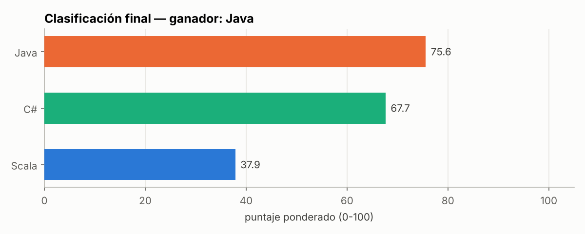
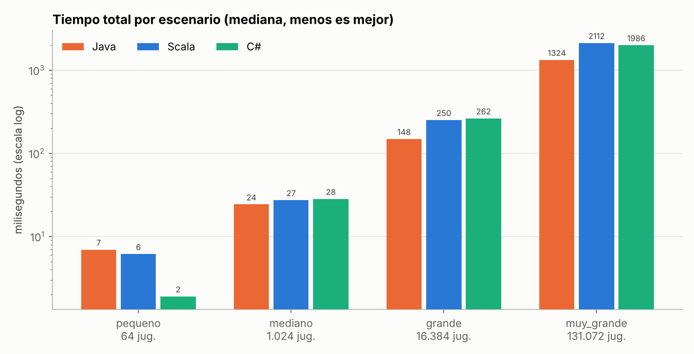
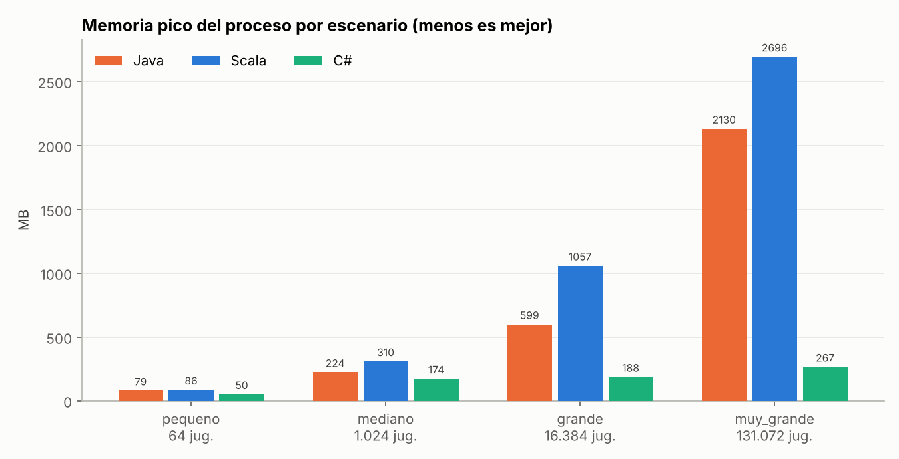
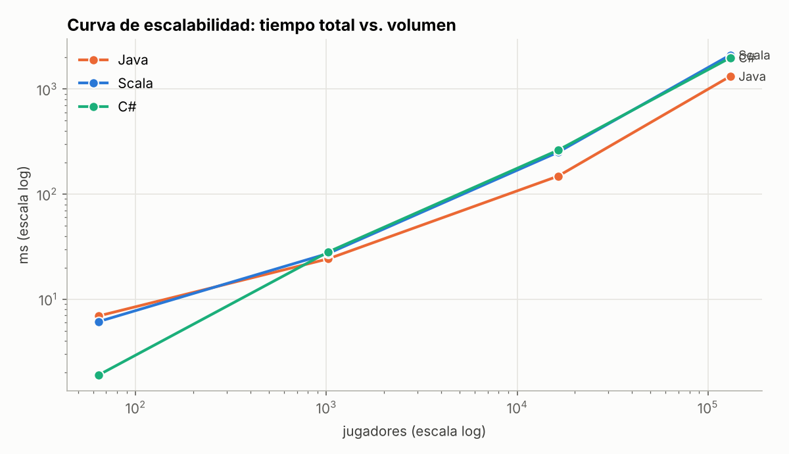
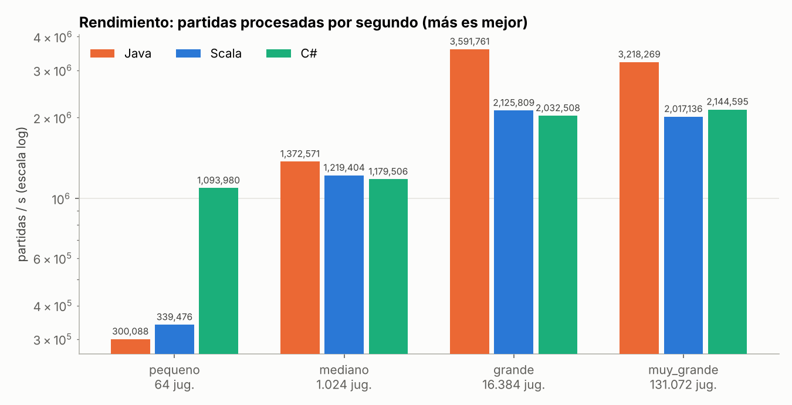
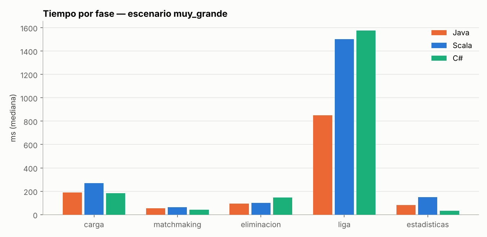
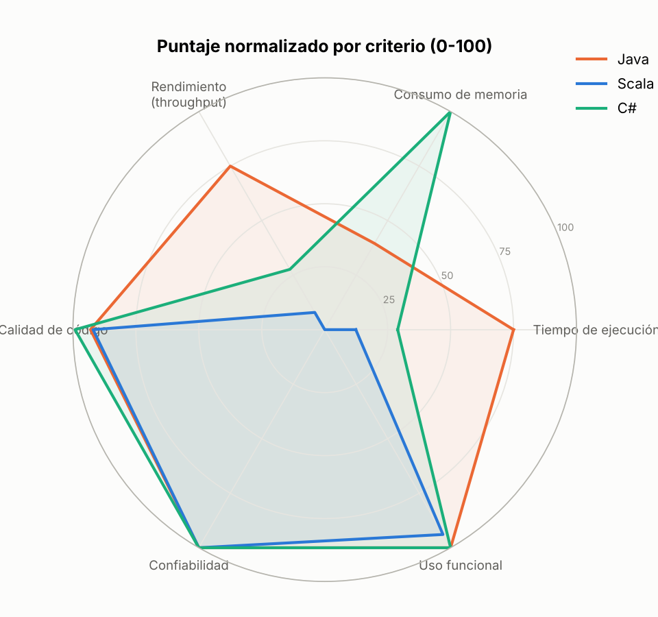

# Reporte automático de comparación — 2026-11-17 00:27

**Ganador determinado automáticamente: Java** (método de normalización: `minmax`).

## Entorno

| Elemento | Valor |
|---|---|
| sistema | Linux 6.18.44-fc-v553 |
| cpu | Intel(R) Xeon(R) Processor @ 2.10GHz |
| nucleosLogicos | 2 |
| ramGB | 7.8 |
| python | 3.13.18 |
| java | openjdk version "21.0.12.1" 2026-08-18 |
| maven | no disponible (se compiló con javac) |
| sbt | no disponible (se compiló con scalac) |
| dotnet | 8.0.134 |
| flagsJVM | -Xms256m -Xmx3g -XX:+UseG1GC |
| modoDotnet | Release (dotnet build -c Release), InvariantGlobalization, TieredPGO |
| fecha | 2026-11-17 00:24 |
| scala | 2.13.16 (compilado con scalac; sbt usa 2.13.14) |
| notas | Servidor sin acceso a Maven Central/NuGet: Java con javac, Scala con scalac 2.13, C# con dotnet build -c Release; pruebas con un ejecutor mínimo compatible con JUnit/MUnit/xUnit |

## Ranking

| Pos. | Lenguaje | Tiempo de ejecución (25 %) | Consumo de memoria (20 %) | Rendimiento (throughput) (20 %) | Calidad de código (15 %) | Confiabilidad (10 %) | Uso funcional (10 %) | **Total** |
|---|---|---|---|---|---|---|---|---|
| 1 | Java | 18,75 | 7,91 | 15,00 | 13,96 | 10,00 | 10,00 | **75,61** |
| 2 | C# | 7,25 | 20,00 | 5,53 | 14,88 | 10,00 | 10,00 | **67,65** |
| 3 | Scala | 3,08 | 0,00 | 1,58 | 13,80 | 10,00 | 9,39 | **37,86** |

## Métrica cruda → normalizada (0-100) → ponderada

| Criterio | Lenguaje | Métrica cruda | Unidad | Normalizado | Ponderado |
|---|---|---|---|---|---|
| Tiempo de ejecución | Java | 75,77 | ms (media geométrica de medianas) | 75,00 | 18,75 |
| Tiempo de ejecución | Scala | 96,97 | ms (media geométrica de medianas) | 12,34 | 3,08 |
| Tiempo de ejecución | C# | 72,68 | ms (media geométrica de medianas) | 28,98 | 7,25 |
| Consumo de memoria | Java | 387,96 | MB pico RSS (media geométrica) | 39,54 | 7,91 |
| Consumo de memoria | Scala | 525,05 | MB pico RSS (media geométrica) | 0,00 | 0,00 |
| Consumo de memoria | C# | 144,53 | MB pico RSS (media geométrica) | 100,00 | 20,00 |
| Rendimiento (throughput) | Java | 1.477.162,43 | partidas/s (media geométrica) | 75,00 | 15,00 |
| Rendimiento (throughput) | Scala | 1.154.260,90 | partidas/s (media geométrica) | 7,90 | 1,58 |
| Rendimiento (throughput) | C# | 1.540.004,01 | partidas/s (media geométrica) | 27,65 | 5,53 |
| Calidad de código | Java | 93,04 | puntaje reglas 0-100 | 93,04 | 13,96 |
| Calidad de código | Scala | 91,99 | puntaje reglas 0-100 | 91,99 | 13,80 |
| Calidad de código | C# | 99,17 | puntaje reglas 0-100 | 99,17 | 14,88 |
| Confiabilidad | Java | 100,00 | puntaje reglas 0-100 | 100,00 | 10,00 |
| Confiabilidad | Scala | 100,00 | puntaje reglas 0-100 | 100,00 | 10,00 |
| Confiabilidad | C# | 100,00 | puntaje reglas 0-100 | 100,00 | 10,00 |
| Uso funcional | Java | 100,00 | puntaje reglas 0-100 | 100,00 | 10,00 |
| Uso funcional | Scala | 93,92 | puntaje reglas 0-100 | 93,92 | 9,39 |
| Uso funcional | C# | 100,00 | puntaje reglas 0-100 | 100,00 | 10,00 |

## Resultados por escenario (mediana de las ejecuciones medidas)

| Escenario | Jugadores | Lenguaje | Mediana ms | Media ms | Desv. ms | Mín ms | Máx ms | Memoria pico MB | Partidas/s |
|---|---|---|---|---|---|---|---|---|---|
| pequeno | 64 | Java | 6,93 | 6,90 | 2,05 | 4,19 | 11,45 | 79,17 | 300.088 |
| pequeno | 64 | Scala | 6,12 | 7,01 | 2,26 | 4,74 | 10,64 | 86,07 | 339.476 |
| pequeno | 64 | C# | 1,90 | 1,88 | 0,20 | 1,54 | 2,16 | 50,10 | 1.093.980 |
| mediano | 1.024 | Java | 24,25 | 25,48 | 6,43 | 13,37 | 34,88 | 224,28 | 1.372.571 |
| mediano | 1.024 | Scala | 27,29 | 26,48 | 5,58 | 16,45 | 36,37 | 309,75 | 1.219.404 |
| mediano | 1.024 | C# | 28,21 | 28,53 | 6,50 | 20,79 | 39,06 | 173,98 | 1.179.506 |
| grande | 16.384 | Java | 148,25 | 165,25 | 33,85 | 135,71 | 230,76 | 598,97 | 3.591.761 |
| grande | 16.384 | Scala | 250,48 | 291,68 | 80,83 | 232,01 | 455,57 | 1.057,48 | 2.125.809 |
| grande | 16.384 | C# | 261,98 | 252,14 | 29,14 | 189,47 | 280,20 | 187,68 | 2.032.508 |
| muy_grande | 131.072 | Java | 1.323,64 | 1.356,43 | 147,13 | 1.188,25 | 1.673,55 | 2.129,98 | 3.218.269 |
| muy_grande | 131.072 | Scala | 2.111,83 | 2.190,64 | 245,31 | 1.955,06 | 2.745,57 | 2.695,75 | 2.017.136 |
| muy_grande | 131.072 | C# | 1.986,31 | 2.001,90 | 139,26 | 1.833,25 | 2.307,42 | 266,76 | 2.144.595 |

## Equivalencia funcional (SHA-256 de la salida normalizada)

| Escenario | Java | Scala | C# | ¿Idénticos? |
|---|---|---|---|---|
| pequeno | `6bd9c41ea521` | `6bd9c41ea521` | `6bd9c41ea521` | ✅ sí |
| mediano | `6249ed99c236` | `6249ed99c236` | `6249ed99c236` | ✅ sí |
| grande | `398b045c96d3` | `398b045c96d3` | `398b045c96d3` | ✅ sí |
| muy_grande | `947605dfea65` | `947605dfea65` | `947605dfea65` | ✅ sí |
| sucio | `5611dc987ed3` | `5611dc987ed3` | `5611dc987ed3` | ✅ sí |
| minimo | `5b6410dcbbab` | `5b6410dcbbab` | `5b6410dcbbab` | ✅ sí |
| inexistente | `e011c81bffcf` | `e011c81bffcf` | `e011c81bffcf` | ✅ sí |

## Confiabilidad

| Lenguaje | Pruebas | Errores manejados | Coincidencia hash | Puntaje |
|---|---|---|---|---|
| Java | 23/23 (100,00 %) | 18/18 (100,00 %) | 100,00 % | 100,00 |
| Scala | 23/23 (100,00 %) | 18/18 (100,00 %) | 100,00 % | 100,00 |
| C# | 23/23 (100,00 %) | 18/18 (100,00 %) | 100,00 % | 100,00 |

## Calidad de código y uso funcional (reglas explícitas)

| Lenguaje | LOC | Funciones | CC prom. | Anidamiento máx. | % funcional | Duplicación % | Efectos fuera de bordes | Cumplimiento | Calidad | Uso funcional |
|---|---|---|---|---|---|---|---|---|---|---|
| Java | 738 | 66 | 2,11 | 4 | 100,00 | 0,00 | 0 | 100,00 % | 93,04 | 100,00 |
| Scala | 586 | 99 | 2,88 | 4 | 87,84 | 0,00 | 0 | 100,00 % | 91,99 | 93,92 |
| C# | 440 | 50 | 2,40 | 3 | 100,00 | 0,00 | 0 | 100,00 % | 99,17 | 100,00 |

**Escáner de Scala:** 0 violaciones de la lista PROHIBIDO; cobertura de la tabla 37/37 (100,00 %). Ver `matriz_cobertura_scala.md`.

## Análisis de sensibilidad (pesos ±5 puntos)

¿Cambia el ganador? **No**. Margen entre 1.º y 2.º: 7,96 puntos. Con normalización `proporcional` el ganador sería **C#**.

| Criterio | Variación | Java | Scala | C# | Ganador |
|---|---|---|---|---|---|
| Tiempo de ejecución | +5 | 75,57 | 36,15 | 65,07 | Java |
| Tiempo de ejecución | -5 | 75,65 | 39,56 | 70,23 | Java |
| Consumo de memoria | +5 | 73,36 | 35,49 | 69,67 | Java |
| Consumo de memoria | -5 | 77,87 | 40,22 | 65,63 | Java |
| Rendimiento (throughput) | +5 | 75,58 | 35,98 | 65,15 | Java |
| Rendimiento (throughput) | -5 | 75,65 | 39,73 | 70,15 | Java |
| Calidad de código | +5 | 76,64 | 41,04 | 69,50 | Java |
| Calidad de código | -5 | 74,59 | 34,67 | 65,80 | Java |
| Confiabilidad | +5 | 76,97 | 41,31 | 69,45 | Java |
| Confiabilidad | -5 | 74,26 | 34,40 | 65,85 | Java |
| Uso funcional | +5 | 76,97 | 40,97 | 69,45 | Java |
| Uso funcional | -5 | 74,26 | 34,74 | 65,85 | Java |

## Gráficos

